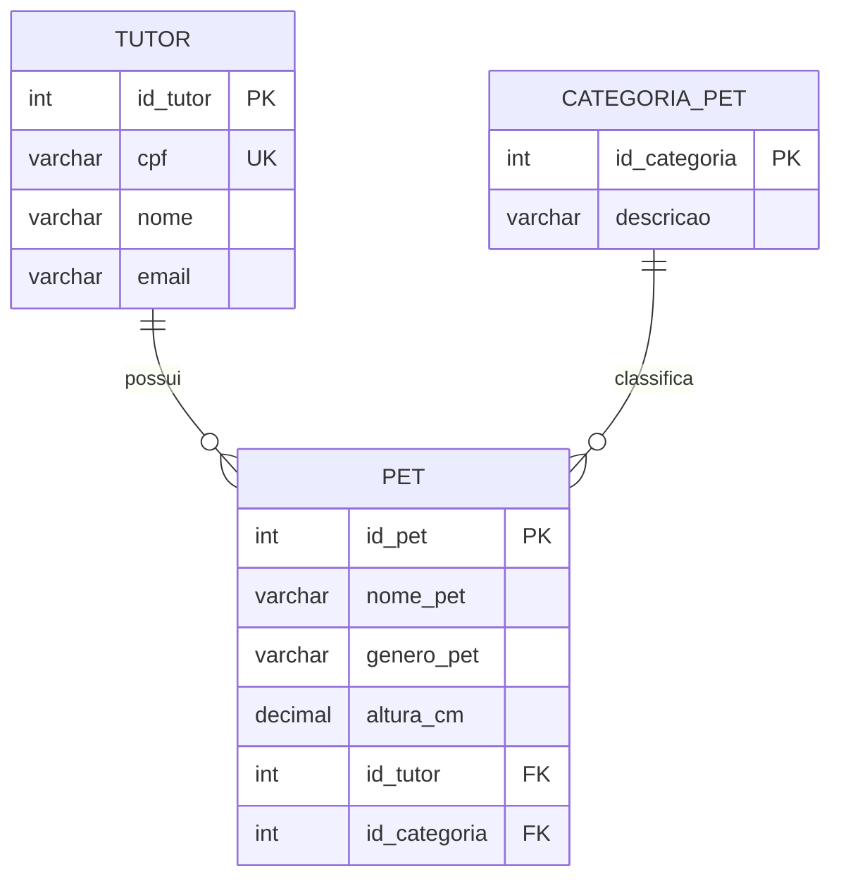

# API de Tutores e Pets

**Status:** em desenvolvimento.

Projeto acadêmico de Programação Server-Side e Banco de Dados. O objetivo é disponibilizar uma **API REST** para gerenciar tutores e seus pets, classificar os animais por altura e consultar informações relacionadas. O projeto também é desenvolvido como portfólio pessoal, com versionamento no Git.

## Funcionalidades previstas

- Cadastro, consulta, atualização e exclusão (CRUD) de tutores e pets.
- Relacionamento de **um tutor para muitos pets**.
- Classificação automática dos pets: **Pequeno** (até 15 cm), **Médio** (mais de 15 e menos de 45 cm) e **Alto** (a partir de 45 cm).
- Consultas de pets por tutor e por categoria.
- Proteção de pelo menos um endpoint com **JWT**.
- Consultas SQL, *views*, *triggers* e *stored procedures* para a atividade de Banco de Dados.
- Testes automatizados das principais regras e rotas.

## Tecnologias

| Tecnologia | Finalidade |
| --- | --- |
| JavaScript e Node.js | Implementação e execução do servidor |
| Express | Rotas HTTP e API REST |
| Sequelize | ORM para a persistência de dados |
| MySQL | Banco de dados relacional |
| CORS | Controle de acesso à API entre origens |
| JWT | Autenticação/autorização de endpoint |
| Jest | Testes automatizados |
| Git e GitHub | Versionamento e publicação do código |

> As dependências e ferramentas de teste serão confirmadas conforme a implementação avançar.

## Banco de dados

A modelagem inicial prevê três tabelas:

| Tabela | Campos principais | Responsabilidade |
| --- | --- | --- |
| `tutor` | `id_tutor` (PK), `cpf` (único), `nome`, `email` | Dados do responsável |
| `pet` | `id_pet` (PK), `nome_pet`, `genero_pet`, `altura_cm`, `id_tutor` (FK), `id_categoria` (FK) | Dados do animal e seus vínculos |
| `categoria_pet` | `id_categoria` (PK), `descricao` | Classificação de altura |

A categoria será definida no banco de dados por **triggers de INSERT e UPDATE** na tabela `pet`. O CPF terá restrição de unicidade, mas não será utilizado como chave primária.

> O nome `categoria_pet` é uma proposta de melhoria em relação a `altura_pet`, nome utilizado no enunciado original; ficará sujeito à confirmação de que essa alteração é permitida.

## Requisitos de Banco de Dados

A atividade prevê **3 consultas SQL** (uma com três tabelas e duas com pelo menos duas), **2 views diferentes dessas consultas**, **2 triggers** e **2 stored procedures** (uma operacional e outra para consulta elaborada).

Os scripts SQL e suas demonstrações serão organizados e documentados durante o desenvolvimento.

## Execução, rotas e testes

Os comandos de instalação, a configuração por variáveis de ambiente, a lista de endpoints e as instruções de testes serão incluídos à medida que forem implementados e validados.

## Organização do projeto

A estrutura de pastas será documentada após sua criação, mantendo a separação necessária entre rotas, modelos, regras de negócio, testes e scripts SQL, sem camadas desnecessárias.
